

# Worldstate

**A generative world model for visual dynamics.**

Built with **PyTorch · ConvVAE · MDN-RNN**.

[Watch the MP4](docs/assets/baseline/rollout.mp4) · [Experiment results](#experiment-results) · [Run it yourself](docs/RUNNING.md) · [Implementation notes](docs/TECHNICAL.md)

  <a href="docs/assets/baseline/rollout.mp4">
    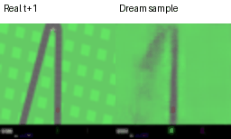
  </a>

*Real future on the left, a sampled imagined future on the right. Click the preview for the [MP4](docs/assets/baseline/rollout.mp4). The GIF plays inline; the MP4 link opens the video file in GitHub, where playback or download is available. Both use the same recorded actions over 20 future steps, slowed to 150 ms per frame for inspection. Model frames are 64 × 64; enlarging the video adds no detail.*

## The experiment

Can a small model learn a compact visual representation of a racing environment, then predict what comes next using only that representation and an action sequence?

This repository implements the vision and memory stages of the World Models idea. A **ConvVAE** compresses RGB observations into 32 latent dimensions. An **LSTM with Gaussian mixtures** learns the distribution of the next latent state. Feeding its sampled predictions back into itself produces an imagined sequence, decoded into images by the VAE.

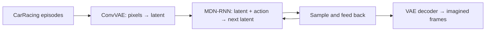

**Current milestone:** smoke and 50-episode baseline runs have saved training histories, held-out evaluations, and rollout visualizations. The project currently evaluates recorded-action replay; controller training and autonomous driving are future work.

## Experiment results

Snapshot of the locally saved experiments, reviewed **2 November 2026**. Lower is better for the losses below. Both runs use seed 42, a 32-dimensional latent space, correlated exploration, and an episode-level train/validation split.

| Setup / held-out metric | Smoke · pipeline check | Baseline · current experiment |
|---|---:|---:|
| Collected episodes | 2 | 50 |
| Steps per episode | 50 | 300 |
| Recorded transitions | 100 | 15,000 |
| Train / validation episodes | 1 / 1 | 40 / 10 |
| VAE / MDN training epochs | 2 / 2 | 20 / 20 |
| LSTM hidden size / mixtures | 64 / 3 | 256 / 5 |
| VAE reconstruction loss ↓ | 489.1713 | **16.7425** |
| VAE KL term | 4.7271 | 13.7062 |
| VAE total loss ↓ | 493.8984 | **30.4487** |
| MDN one-step NLL ↓ | 48.1689 | **35.5508** |
| Stationary unit-Gaussian NLL ↓ | 61.4880 | 51.2286 |
| NLL improvement over own Gaussian comparator | 13.3190 | **15.6779** |

The baseline MDN assigns higher likelihood to held-out next latents than its stationary Gaussian comparator. The larger run also has substantially lower reconstruction loss. These runs change data volume, training duration, and model capacity together, so this is an exploratory comparison rather than a controlled ablation. Each VAE learns a different latent representation; NLL across runs is not a shared-space benchmark.

Reconstruction is squared error summed over 64 × 64 × 3 values, averaged over frames, with the posterior mean decoded. Total VAE loss is reconstruction + KL (`beta = 1`). MDN NLL is **nats per transition, summed over 32 latent dimensions**, using sampled posterior latents and context reset per sequence window. Evaluation NLL is reported from the saved evaluation JSON, separately from the training history.

Sources: [smoke VAE](docs/experiments/smoke/vae_evaluation.json), [smoke MDN](docs/experiments/smoke/mdn_evaluation.json), [baseline VAE](docs/experiments/baseline/vae_evaluation.json), [baseline MDN](docs/experiments/baseline/mdn_evaluation.json). [Saved configs, splits, and histories](docs/experiments/README.md) accompany this snapshot.

### How far can it imagine?

| Future horizon | Smoke: endpoint latent MSE ↓ | Baseline: endpoint latent MSE ↓ |
|---|---:|---:|
| 1 step | 1.3858 | 0.7092 |
| 5 steps | 0.9627 | 0.7063 |
| 10 steps | 1.4387 | 0.8466 |
| 20 steps | 0.9869 | 0.9532 |

Arithmetic means over the saved episode/trajectory pairs at each horizon: smoke uses **1 validation episode × 3 trajectories**; baseline uses **10 × 5**. Each value compares the generated endpoint latent to the real frame's posterior mean. This is a sample-error diagnostic, not a distributional score or driving score. One-step likelihood alone does not establish coherent long-horizon predictions.

Sources: [smoke rollout records](docs/experiments/smoke/rollout.json) · [baseline rollout records](docs/experiments/baseline/rollout.json).

## Inside the learned world

### Real → reconstructed → imagined

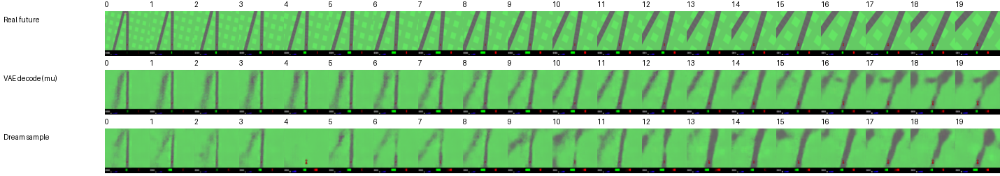

The top row is the real future. The middle row decodes the real frames' posterior means, exposing representation error. The bottom row is a free-running sampled prediction: future observed latents are never fed back into generation. The preview retains broad colors and track structure, while fine detail blurs and the imagined sequence drifts.

### What the VAE sees

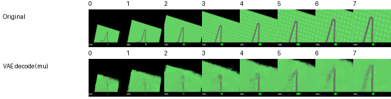

### Multiple possible futures

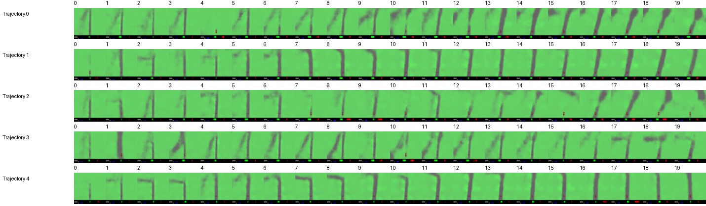

Different seeds sample different futures under the same action sequence. Variation shows the model's stochastic outputs; it does not by itself establish calibrated uncertainty.

<strong>Smoke run: training results and rollout</strong>

Two episodes, 50 steps per episode, and two epochs per model. A small workflow check with visibly limited learned detail.

#### Vision: VAE training

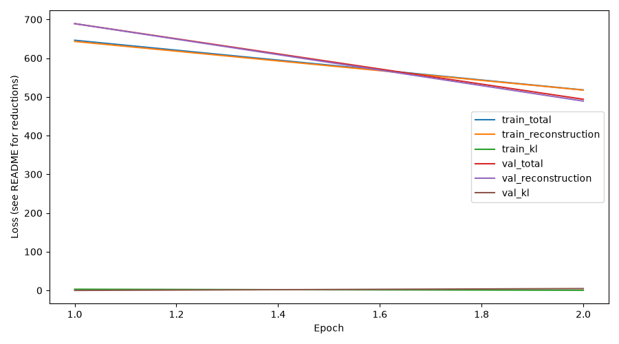

#### Memory: MDN-RNN training

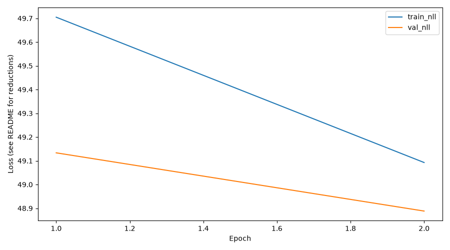

#### Dataset preview

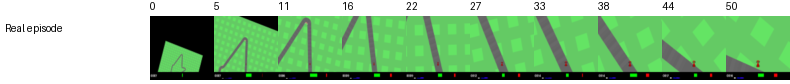

#### Result: actual vs imagined

  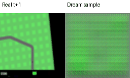

Real future on the left; a sampled imagined future on the right.

<strong>Baseline run: training results and rollout</strong>

50 episodes, 300 steps per episode, and 20 epochs per model. The larger experiment behind the current baseline results.

#### Vision: VAE training

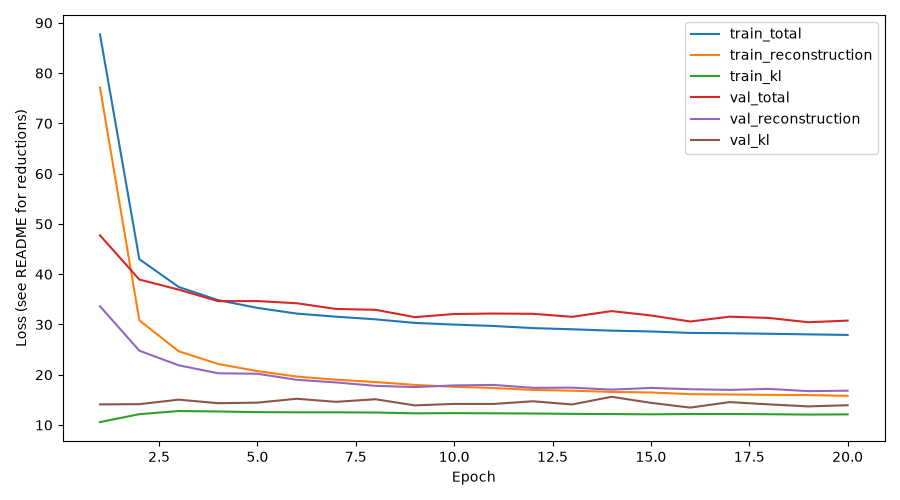

#### Memory: MDN-RNN training

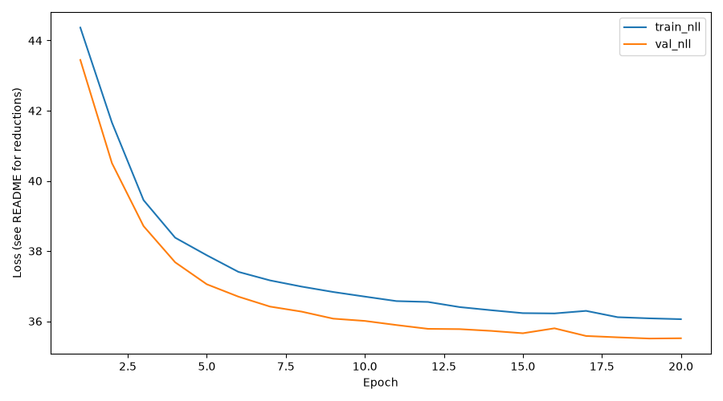

#### Dataset preview

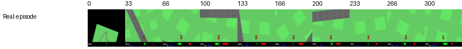

#### Result: actual vs imagined

  

Real future on the left; a sampled imagined future on the right.

[Watch the baseline MP4](docs/assets/baseline/rollout.mp4).

## Continue exploring

- **[Run the experiments](docs/RUNNING.md)** — installation, staged training, evaluation, and MP4 export.
- **[Read the implementation](docs/TECHNICAL.md)** — data contracts, architecture, losses, rollout protocol, and repository map.
- **[Inspect the experiment snapshot](docs/experiments/README.md)** — source metrics and resolved settings behind these tables.
- **[Validation record](docs/validation.md)** — saved experiment evidence and historical implementation checks.
- **[Controller next steps](docs/controller_next_steps.md)** — the deferred control stage.

This is an educational implementation inspired by **[Ha & Schmidhuber, World Models (2018)](https://worldmodels.github.io/)**. It uses Gymnasium CarRacing-v3, small exploratory datasets, and independent sequence-window training. It does not yet implement reward/termination prediction, an interactive dream environment, policy evolution, or reproduction of the paper's driving scores.
